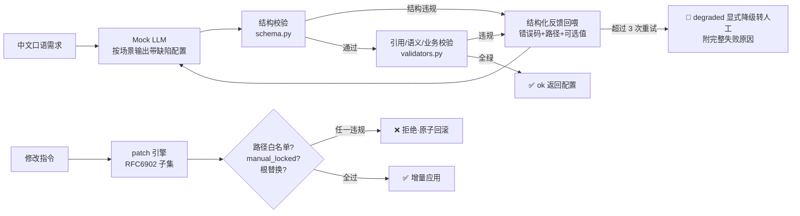

# sprout-nl2config

> **自然语言 → 低代码平台私有配置的约束生成层**（问题③）
>
> 让 LLM 把中文口语需求**确定性**地翻译成 100% 合法的低代码平台配置树——不存在"输出大概是对的"这个状态。


## 对应岗位难题

末龙科技 AI 应用工程师岗·三大技术难题之**问题③**：私有 DSL 约束生成。LLM 原生输出空间是自由文本，目标是带四层约束（结构/引用/语义/业务）的形式语言，两个空间性质根本不同——这不是"prompt 写得好不好"，是**受限形式语言生成**问题。

## 架构



五层解法（详见 [docs/04-修复设计与引用.md](docs/04-修复设计与引用.md)）：
1. **结构约束**——手写 schema 校验器钉住字段名/类型/嵌套/必填/枚举；
2. **校验-修复循环**——结构化错误反馈（含合法可选值）+ 3 次重试上限 + 显式降级转人工；
3. **合法枚举注入**——注册表 + 错误信息携带可选值，教会模型"下次怎么改"；
4. **编辑走 patch**——路径白名单 + `manual_locked` 锁 + 根替换禁止，**架构上**杜绝全量重写覆盖人工修改；
5. **golden 回归评测集**——8 对需求→期望配置，量化一次通过率/收敛率/幻觉 ID 率。

## 快速开始

```bash
# 需求 → 配置（幻觉 ID 场景，第 2 轮收敛）
python3 -m nl2config.cli generate --requirement "做个视频站" --scenario hallucinated_id

# 不可纠正场景 → 显式降级转人工（附失败原因）
python3 -m nl2config.cli generate --requirement "顽固场景" --scenario stubborn

# 受约束增量修改（触锁即拒）
python3 -m nl2config.cli patch --config examples/site.json \
  --patch examples/patch.json --locked /pages/0/components/1/props

# golden 回归（含指标）
python3 -m nl2config.cli regress
```

## 验证

```bash
python3 -m unittest discover -s tests -v   # 21 项全绿
```

修复前后的完整对比见 [docs/06-回归记录.md](docs/06-回归记录.md)：同一套测试在缺陷基线上 **26 项失败**，修复后 **21/21 通过**；golden 指标一次通过率 37.5%、含重试收敛率 100%、幻觉 ID 率 12.5%（全部被循环捕获并修复）。

## 目录结构

```
nl2config/
  schema.py        # 第一层：结构约束校验器
  validators.py    # 二~四层：引用/语义/业务校验（结构化错误+可选值）
  generator.py     # 校验-修复循环 + 显式降级
  patch_engine.py  # 第四层：增量 patch（白名单/锁/全量重写防护/原子性）
  golden.py        # 第五层：回归评测集与指标
  mock_llm.py      # 确定性 Mock：12 场景复现真实失败模式
  registry.py      # 平台资产注册表（组件/模板/套餐/广告位约束，带版本）
  api.py           # 稳定 API 表面（baseline 与最终态共用签名）
tests/             # 21 项回归测试（baseline 上 26 项失败 = 复现材料）
data/golden/       # 8 对 golden pairs
docs/              # 问题报告 / 复现 / 调研 / 设计 / 覆盖 / 回归
examples/          # CLI 演示样例
```

## 工程过程

本仓库按真实工程流程搭建：问题报告见 [Issue #1](https://github.com/kaijie0074-art/sprout-nl2config/issues/1)，修复走 [PR #2](https://github.com/kaijie0074-art/sprout-nl2config/pull/2)（含评审意见、采纳记录、负责人验收），发布记录见 [Releases](https://github.com/kaijie0074-art/sprout-nl2config/releases)。

## 声明

**模拟项目**：为末龙科技 AI 应用工程师岗三大技术难题的工程化模拟（2026-10）。LLM 为确定性 Mock（验证约束层工程而非模型能力）；低代码平台 schema 为虚构样本；技术路线源自公开调研与业务链路推演，非该公司内部实证。开源调研引用见 [docs/03](docs/03-开源调研.md)。
